# 코디세이 E1-3: Mini NPU Simulator

1. [실행 방법](#실행-방법)
2. [구현 요약](#구현-요약)
3. [결과 리포트](#결과-리포트)

## 실행 방법

### 실행 환경과 기본 명령

Python 3.8 이상에서 표준 라이브러리만 사용합니다. `main.py`가 있는 폴더에서 실행합니다.

```text
python main.py
```

### 모드 선택

1. 직접 입력하기(3×3): 필터 A, 필터 B, 패턴을 각각 세 줄씩 입력합니다. 한 줄에는 공백으로 나눈 숫자 세 개를 넣습니다. 잘못 입력한 행은 다시 받습니다.
2. JSON 전체 보기: `main.py` 옆의 과제 제공 `data.json`을 읽어 전체 판정, 성능 분석, 결과 요약을 출력합니다.
3. JSON 한 개 보기: 기본 여섯 케이스 중 번호를 고르거나 케이스 이름을 직접 입력합니다. 요약도 선택한 한 건 기준입니다.
4. 오류 예제 보기: 별도 파일 `examples/size-error.json`으로 크기 오류 한 건과 정상 한 건을 확인합니다.
5. 보너스: 패턴 자동 생성 보기: 크기 N을 입력하면 N×N 십자가와 X 숫자 배열을 바로 출력합니다.

원문의 두 필수 모드는 1번과 2번입니다. 3번과 4번은 결과 설명을 위한 보조 메뉴이며, 5번은 보너스 과제 확인 메뉴입니다.
결과가 나온 뒤에는 입력을 기다립니다. Enter를 누르면 메뉴로 돌아가며, `q`를 입력한 뒤 Enter를 누르면 종료합니다.
첫 메뉴에서도 `q`로 종료할 수 있습니다.

```text
python main.py --mode 1
python main.py --mode 2
python main.py --mode 2 --case size_5_1
python main.py --mode 2 --data "다른폴더/data.json"
```

### data.json 위치

과제 제공 `data.json`을 `main.py`와 같은 폴더에 둡니다.

### 직접 입력 예시

`python main.py` 실행 후 메뉴에서 `1`을 선택합니다.
화면에 나오는 **필터 A → 필터 B → 패턴** 순서로 입력합니다.
각 `1행:`, `2행:`, `3행:` 안내 뒤에 숫자 세 개를 공백으로 구분해 입력하고 Enter를 누릅니다.

이 예시에서는 A를 십자가 필터, B를 X 필터로 정하고, 판별할 패턴으로 X를 입력합니다.

| 입력 대상 | 1행에 입력 | 2행에 입력 | 3행에 입력 |
|---|---|---|---|
| 필터 A: 십자가 | `0 1 0` | `1 1 1` | `0 1 0` |
| 필터 B: X | `1 0 1` | `0 1 0` | `1 0 1` |
| 패턴: 판별할 X | `1 0 1` | `0 1 0` | `1 0 1` |

**입력 화면**

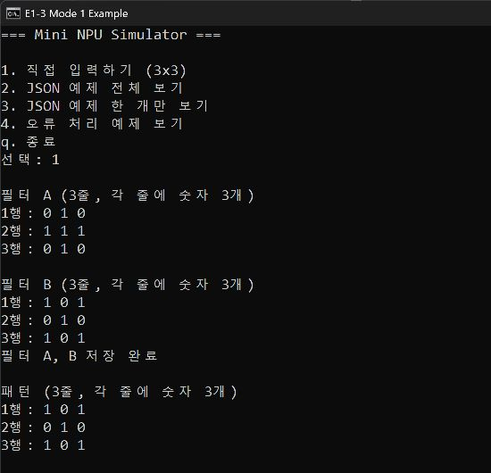

**실행 결과**

A 점수는 1, B 점수는 5이므로 판정은 **B**입니다. 이 예시에서 B는 X 필터입니다.
3×3 MAC의 평균 시간과 연산 횟수 9도 출력합니다. 측정 시간은 실행할 때마다 달라집니다.

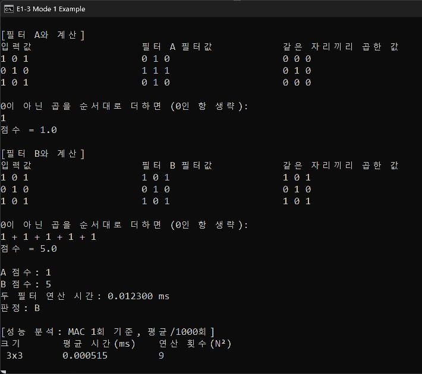

## 구현 요약

### 라벨 정규화

`normalize_label()`은 expected의 `+`와 필터 키의 `cross`를 `Cross`로, `x`를 `X`로 바꿉니다.
콘솔에서는 표준 라벨을 유지하면서 `십자가(Cross)`, `엑스(X)`, `판정 불가(UNDECIDED)`로 설명합니다.
`정답`은 정규화한 expected이고, 판정과 일치할 때 `통과(PASS)`, 다르면 `실패(FAIL)`입니다.

**관련 코드 · [main.py의 normalize_label()](main.py#L18)**

```python
def normalize_label(value):
    if not isinstance(value, str):
        raise ValueError('라벨은 문자열이어야 합니다.')
    labels = {'+': 'Cross', 'cross': 'Cross', 'x': 'X'}
    try:
        return labels[value.strip().lower()]
    except KeyError:
        raise ValueError('알 수 없는 라벨: {!r}'.format(value))
```

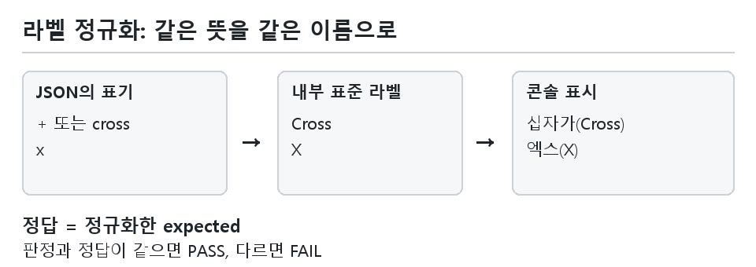

### MAC 연산

2차원 리스트에서 같은 위치의 두 값을 곱해 누적합니다. `mac()`은 검증된 같은 크기의 배열을 받아 float 점수를 반환합니다.
NumPy 등의 외부 라이브러리는 사용하지 않습니다.

**관련 코드 · [main.py의 mac()](main.py#L50)**

```python
def mac(pattern, kernel):
    total = 0.0
    for i in range(len(pattern)):
        for j in range(len(pattern)):
            total += pattern[i][j] * kernel[i][j]
    if not math.isfinite(total):
        raise ValueError('MAC 결과가 유한하지 않습니다(수치 범위 초과).')
    return total
```

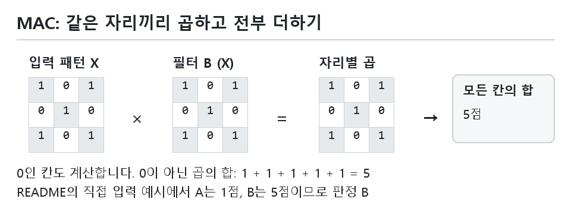

<details>
<summary>실제 MAC 계산 실행 화면</summary>


</details>

### 동점 처리 정책

`abs(score_a - score_b) < 1e-9`이면 동점으로 판정합니다. 정확히 문턱과 같은 차이는 동점에 포함하지 않습니다.
동점의 반환값은 `UNDECIDED`입니다. 과제 데이터의 expected는 Cross 또는 X이므로 동점 판정은 FAIL입니다.

**관련 코드 · [main.py의 decide()](main.py#L60)**

```python
EPSILON = 1e-9
```

```python
def decide(a, b, label_a='Cross', label_b='X'):
    if abs(a - b) < EPSILON:
        return 'UNDECIDED'
    return label_a if a > b else label_b
```

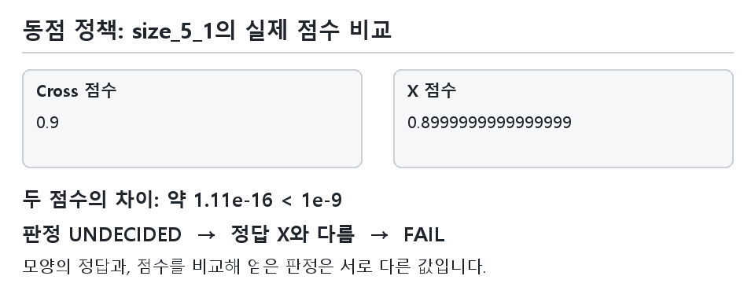

### JSON 구조와 입력 검증

`filters` 아래 `size_5`, `size_13`, `size_25`에 각각 `cross`, `x` 필터가 있습니다.
`patterns`의 `size_N_idx` 키에서 N을 추출해 필터를 선택하고, `input`과 `expected`를 검사합니다.
최상위 `meta`는 파일의 메타 정보이며 MAC 판정에는 사용하지 않습니다.
필터·패턴의 행과 열 수, 숫자 타입, 유한성을 확인합니다. 케이스 오류는 FAIL과 사유를 남기고 다음 케이스를 처리합니다.

**관련 코드 · [main.py의 analyze()](main.py#L200)**

JSON 파일 읽기:

```python
with open(path, encoding='utf-8-sig') as file:
    data = json.load(file)
```

필터의 라벨을 정규화하고 배열 검증하기(발췌):

```python
group = filters.get('size_{}'.format(n))
if not isinstance(group, dict):
    raise ValueError('size_{} 필터 객체가 없습니다.'.format(n))
normalized = {}
for key, matrix in group.items():
    label = normalize_label(key)
    if label in normalized:
        raise ValueError('정규화 후 필터 라벨 중복: ' + label)
    normalized[label] = validate_matrix(matrix, n)
```

케이스 이름에서 크기를 읽고 입력·정답을 검증하기(발췌):

```python
match = re.fullmatch(r'size_(5|13|25)_([0-9]+)', key)
if not match:
    raise ValueError('패턴 키는 size_{5/13/25}_{idx} 형식이어야 합니다.')
n = int(match.group(1))
if n not in loaded:
    raise ValueError('필터 오류: ' + errors[n])
if not isinstance(case, dict):
    raise ValueError('패턴 케이스는 객체여야 합니다.')
pattern = validate_matrix(case.get('input'), n)
expected = normalize_label(case.get('expected'))
```

배열의 행·열 수, 숫자 타입과 유한성 검사는 [main.py의 validate_matrix()](main.py#L28)에서 수행합니다.

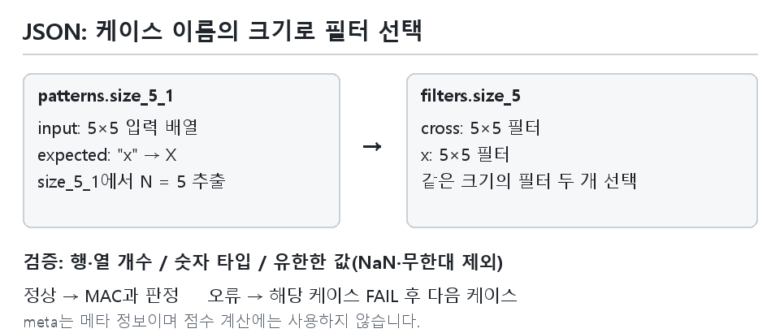

### 숫자 표시와 실제 가중치

현재 데이터의 input은 0과 1이지만 필터에는 0.1, 0.3, 0.9, 4.9, 7.5 등의 가중치가 있습니다.
콘솔에는 입력값, 필터값, 같은 자리끼리 곱한 값을 숫자 행렬로 표시합니다.
0이 아닌 곱을 순서대로 나열한 덧셈식과 실제 누적 점수도 출력합니다.
화면 너비를 넘는 큰 행렬은 열 범위를 표시하여 나눠 출력합니다.
점수는 **원래 숫자끼리 곱한 합계**입니다. 예를 들어 size_5_1에서 십자가 기준은 중앙의 0.9, X 기준은 0.1 아홉 개의 합이므로 두 점수가 허용오차 안에서 같습니다.

**관련 코드 · [main.py의 show_patterns()](main.py#L113)**

```python
products = [[pattern[i][j] * kernel[i][j] for j in range(size)]
            for i in range(size)]
show_matrices([('입력값', pattern), (name + ' 필터값', kernel),
               ('같은 자리끼리 곱한 값', products)])
terms = [number_text(v) for row in products for v in row if v != 0]
expression = ' + '.join(terms) if terms else '0'
```

`products`는 자리별 곱, `terms`와 `expression`은 화면에 보여 줄 덧셈식입니다. 판정에 쓰는 점수는 `mac()`이 모든 칸을 순서대로 더해 계산합니다.

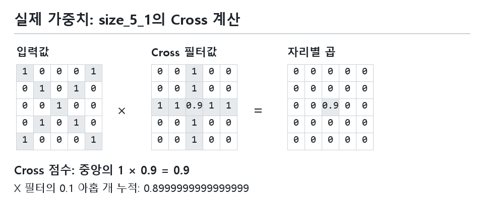

<details>
<summary>실제 5×5 가중치 계산 실행 화면</summary>

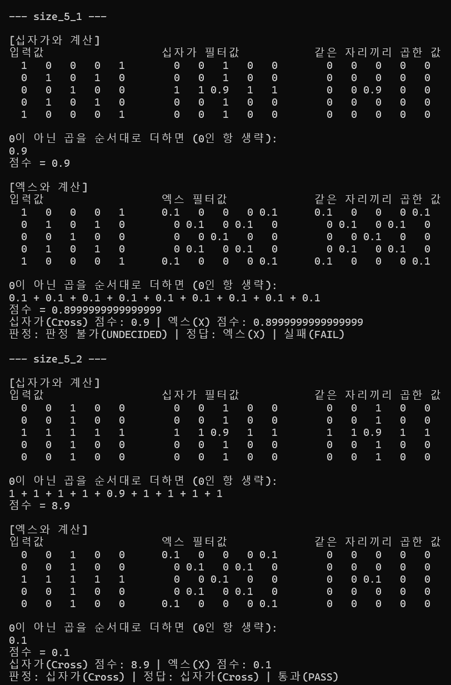

</details>

### 보너스 과제: 패턴 생성기

`generate(n)`은 중앙 행·열의 십자가와 두 대각선의 X를 0/1 배열로 만듭니다.

**직접 확인하기:** `python main.py` 실행 → 메뉴 `5` 선택 → 크기 N 입력.
예를 들어 N에 `5`를 입력하면 **5×5 십자가와 X 배열**을 화면에서 확인할 수 있습니다.
1은 선이 있는 칸, 0은 빈칸입니다. 결과 확인 후 Enter를 누르면 메뉴로 돌아갑니다.

`python main.py --generated-filters`는 모드 1에서 3×3 필터를 자동 생성해 화면에 표시하고, 판별할 패턴만 입력받습니다.
성능 분석도 같은 함수로 3·5·13·25 크기의 입력을 준비합니다. 생성기는 과제 제공 가중치 파일과 독립된 규칙입니다.

구현 위치: [자동 생성 함수](main.py#L66) → [5번 메뉴의 결과 표시 함수](main.py#L162).

**관련 코드 · [main.py의 generate()](main.py#L66)**

```python
def generate(n):
    """Return a center cross and both diagonals as n-by-n matrices."""
    cross = [[float(i == n // 2 or j == n // 2) for j in range(n)] for i in range(n)]
    x = [[float(i == j or i + j == n - 1) for j in range(n)] for i in range(n)]
    return cross, x
```

`n // 2`는 중앙 위치, `i == j`와 `i + j == n - 1`은 두 대각선 조건입니다. 조건이 참이면 `float(True)`인 1.0, 거짓이면 0.0을 넣습니다.

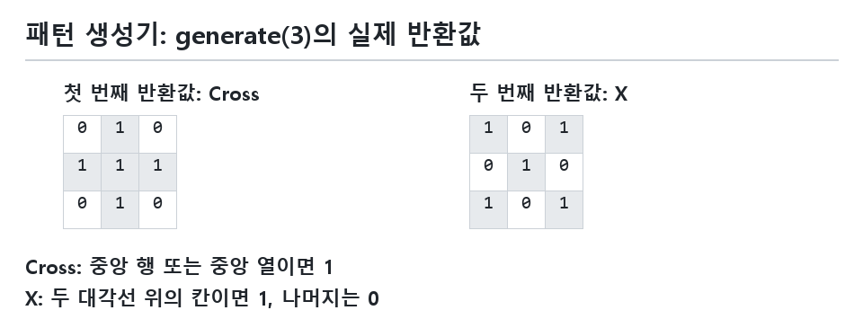

## 결과 리포트

### 판정 결과와 실패 원인 분석

과제 제공 `data.json`의 실행 결과는 **총 6건 / 통과 3건 / 실패 3건**입니다.

| 케이스 | Cross 점수 | X 점수 | 판정 | 정답 | 결과 |
|---|---:|---:|---|---|---|
| size_5_1 | 0.9 | 0.8999999999999999 | UNDECIDED | X | FAIL |
| size_5_2 | 8.9 | 0.1 | Cross | Cross | PASS |
| size_13_1 | 0.3 | 14.700000000000008 | X | X | PASS |
| size_13_2 | 7.499999999999997 | 7.5 | UNDECIDED | Cross | FAIL |
| size_25_1 | 4.9 | 4.899999999999999 | UNDECIDED | X | FAIL |
| size_25_2 | 52.9 | 0.1 | Cross | Cross | PASS |

1. size_5_1의 점수는 0.9와 0.8999999999999999이며, 차이는 약 1.11e-16입니다.
2. 이 차이는 epsilon보다 작아 UNDECIDED이며 expected X와 달라 FAIL입니다.
3. size_13_2의 점수는 7.499999999999997과 7.5이며, 차이는 약 2.66e-15입니다.
4. 이 역시 UNDECIDED이며 expected Cross와 달라 FAIL입니다.
5. size_25_1의 점수는 4.9와 4.899999999999999이며, 차이는 약 1.78e-15입니다.
6. 이 역시 UNDECIDED이며 expected X와 달라 FAIL입니다.
7. 세 케이스 모두 스키마와 크기 검증은 통과했습니다. 실패 원인은 허용오차 기반 동점 판정과 정답 라벨의 불일치입니다.
8. 파일 숫자의 십진 표기를 정확히 곱해 합산한 보조 확인에서도 세 쌍은 각각 0.9/0.9, 7.5/7.5, 4.9/4.9입니다.
9. 따라서 미세한 float 차이로 한쪽을 승자로 고르는 대신 원문의 동점 정책을 적용했습니다.
10. 나머지 size_5_2, size_13_1, size_25_2는 각각 Cross, X, Cross로 판정되어 정답과 일치했습니다.
11. +와 cross를 Cross로, x를 X로 정규화하여 단순한 문자열 표기 차이 때문에 실패하지 않도록 했습니다.
12. 점수 비교에는 전체 float 값을 쓰며 콘솔 표시 자릿수는 비교 결과에 영향을 주지 않습니다.

### 시간 복잡도와 성능 분석

13. MAC 한 번은 N행에서 N열을 방문하므로 N²단계입니다.
14. 각 단계에서 곱셈 한 번과 누적 덧셈 한 번을 수행하므로 각각 N²회입니다.
15. 두 필터를 비교하면 2N²단계지만 시간 복잡도는 여전히 O(N²)입니다.
16. 표의 단계 수는 3×3에서 9, 5×5에서 25, 13×13에서 169, 25×25에서 625입니다.
17. 준비 호출 한 번 후 MAC 1,000회를 재어 한 번의 평균 ms를 출력했습니다.
18. 파일 읽기·화면 출력·배열 생성은 타이머 밖에 있고, 반복 제어와 함수 호출 비용은 포함됩니다.
19. 성능 표의 입력은 generate()가 만든 0/1 배열이며, 과제 파일의 케이스별 처리 시간을 나타내는 표와는 측정 대상이 다릅니다.
20. N²은 반복문 구조에서 얻은 연산량이며 실제 시간은 Python 버전, 시스템 부하, 고정 비용에 따라 달라집니다.
21. 입력과 필터의 저장 공간은 O(N²), MAC 자체의 추가 저장 공간은 O(1)입니다.
22. 아래 표는 이번 실제 실행 한 차례의 측정값입니다. 재실행하면 수치는 달라질 수 있습니다.

실행 환경 · Windows, CPython 3.13.3, 반복 1,000회.

| 크기 | 평균 시간(ms), MAC 1회 | MAC 단계 수 N² |
|---|---:|---:|
| 3×3 | 0.000493 | 9 |
| 5×5 | 0.001689 | 25 |
| 13×13 | 0.009231 | 169 |
| 25×25 | 0.028698 | 625 |

### 재현성 확인

- CPython 3.8.10과 3.13.3에서 메뉴 1~4를 실행해 같은 6건 판정 및 요약을 확인했습니다.
- 모드 1의 X 판정, 잘못된 숫자·열 수의 재입력, 같은 필터의 동점 처리를 확인했습니다.
- 모드 2에서 배열 크기 오류와 잘못된 라벨을 복사본으로 만들어 케이스별 실패와 후속 처리를 확인했습니다.
- 정규화, epsilon 경계값, 3×3 자동 필터도 확인했습니다.

#### 오류 시연

4번 메뉴 또는 아래 명령으로 별도 오류 예제 `examples/size-error.json`을 실행합니다.

```text
python main.py --mode 2 --data examples/size-error.json
```

첫 케이스 `size_5_1`의 첫 행만 숫자가 4개이며, 나머지 행은 5개입니다.

```text
오류 행 (4개): [0.0, 0.0, 1.0, 0.0]
정상 행 (5개): [0.0, 0.0, 1.0, 0.0, 0.0]
```

첫 행 끝에 `0.0` 하나를 복원하면 크기 검증을 통과합니다.
첫 케이스는 5개여야 할 열이 4개여서 FAIL, 두 번째는 PASS이며 요약은 총 2건 / 통과 1건 / 실패 1건입니다.
이는 데이터/스키마 오류를 보여 주는 예이고, 과제 제공 파일의 세 실패는 동점 비교 정책에 따른 결과입니다.

### 실행 화면과 기록

#### 5×5: 동점으로 판정 불가가 된 예

`size_5_1`의 입력은 X입니다. 십자가 필터로는 가운데의 `1 × 0.9`만 더해지고, X 필터로는 `1 × 0.1` 아홉 개가 더해집니다.

| 비교 기준 | 0이 아닌 곱의 합 | 실제 누적 점수 |
|---|---|---:|
| 십자가(Cross) | 0.9 | 0.9 |
| 엑스(X) | 0.1을 9번 더함 | 0.8999999999999999 |

두 점수의 차이가 `1e-9`보다 작아 판정은 UNDECIDED입니다.
파일의 정답 X와 다르므로 FAIL로 기록됩니다.

```text
판정: 판정 불가(UNDECIDED) | 정답: 엑스(X) | 실패(FAIL)
```

#### 5×5: 정상 통과한 예

`size_5_2`는 십자가 입력입니다. Cross 점수가 X 점수보다 높고, 판정이 정답과 일치합니다.

```text
십자가(Cross) 점수: 8.9 | 엑스(X) 점수: 0.1
판정: 십자가(Cross) | 정답: 십자가(Cross) | 통과(PASS)
```

<details>
<summary>5×5 계산 과정 원본 펼치기 — 입력값·필터값·위치별 곱</summary>


</details>

#### 13×13·25×25 결과 확인

위의 판정 결과 표에 여섯 케이스의 점수와 PASS/FAIL을 모두 기록했습니다.
큰 행렬의 실제 계산 화면은 크기별로 펼쳐 볼 수 있습니다.

<details>
<summary>13×13 원본 펼치기 — X 통과와 십자가 동점 실패</summary>

`size_13_1`은 Cross 0.3, X 14.700000000000008로 X 판정에 통과합니다.
`size_13_2`는 Cross 7.499999999999997, X 7.5의 차이가 작아 동점으로 실패합니다.

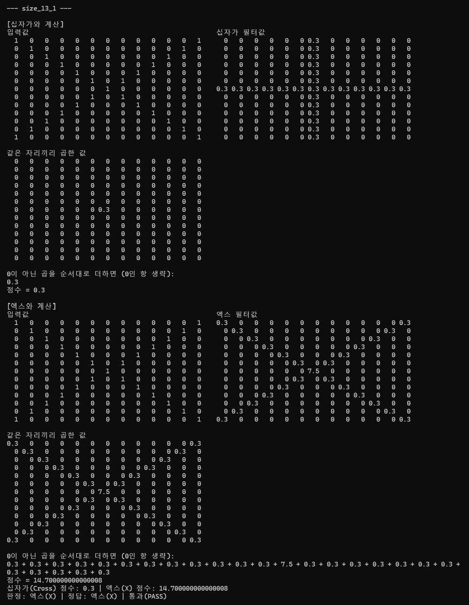

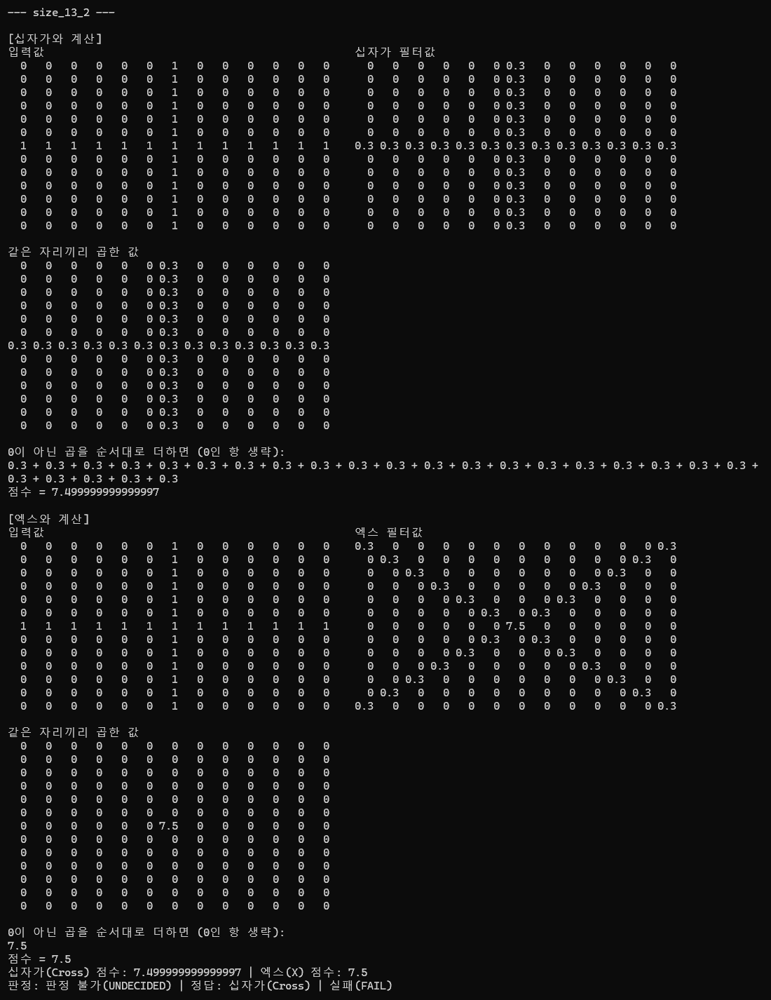

</details>

<details>
<summary>25×25 원본 펼치기 — X 동점 실패와 십자가 통과</summary>

캡처 순서대로 나열했습니다. `size_25_1`은 동점 FAIL, `size_25_2`는 Cross 판정 PASS입니다.

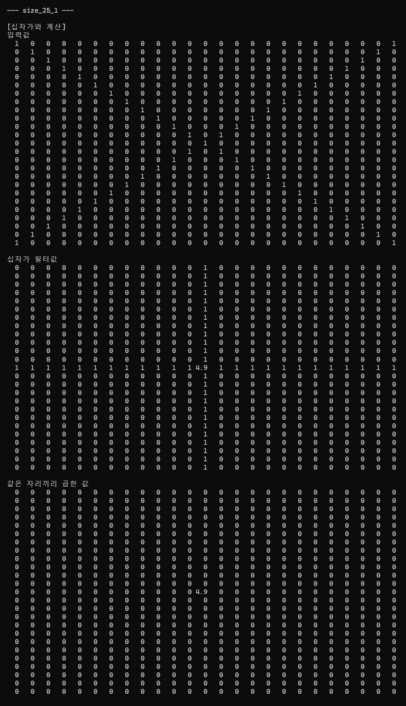

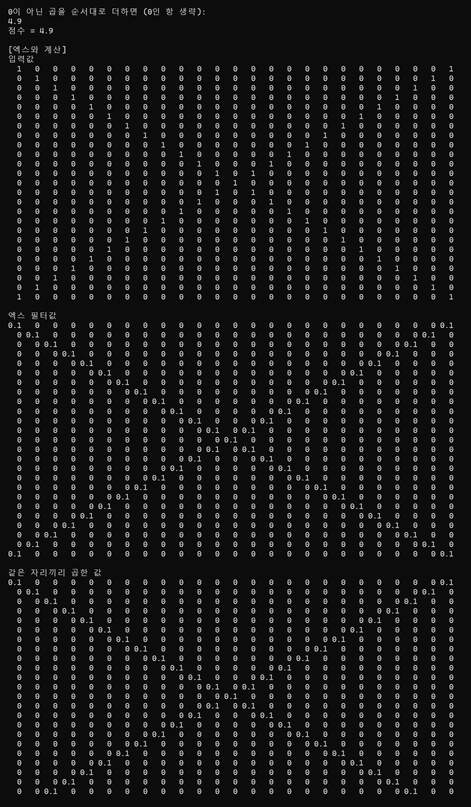

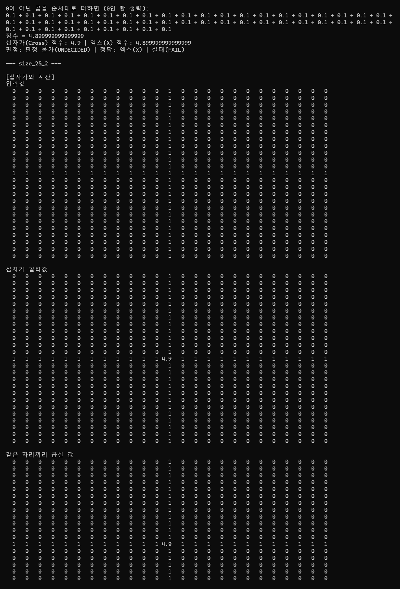

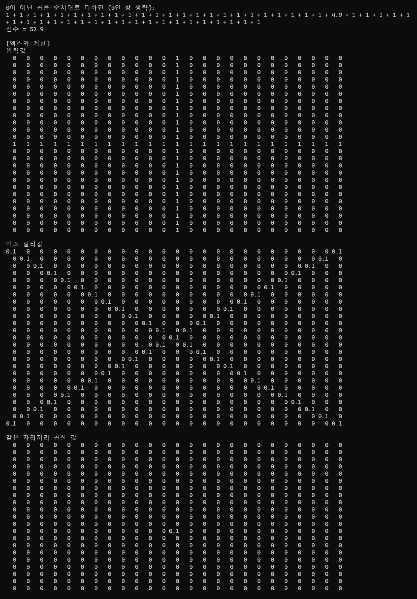

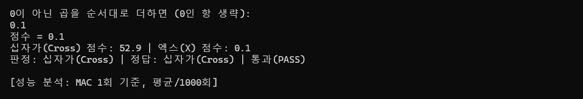

</details>

#### 성능 분석과 최종 요약

최종 결과는 **총 6건 / 통과 3건 / 실패 3건**입니다.
실패한 `size_5_1`, `size_13_2`, `size_25_1`은 모두 동점 규칙에 따른 정답 불일치입니다.
아래는 실제 성능 표와 요약 화면입니다.

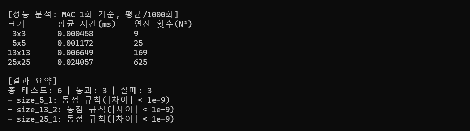

스크린샷의 평균 시간과 위 성능 표는 별도 실행에서 측정한 값으로, 실행 시점에 따라 시간이 달라집니다.
전체 숫자 행렬과 계산 출력은 [example_result.txt](example_result.txt)에서도 확인할 수 있습니다.


### 데이터 확인 자료

설명과 결과에 사용한 입력 패턴 및 필터값입니다. 큰 이미지는 아래에서 펼쳐 볼 수 있습니다.

<details>
<summary>과제 제공 data.json의 입력 패턴과 크기별 필터값 펼치기</summary>

#### 입력 패턴

아래 그림은 과제 제공 파일의 실제 입력 패턴입니다. 각 크기의 1번은 X 입력, 2번은 십자가 입력입니다.


#### 실제 JSON 필터 발췌

파일의 숫자와 키를 유지하면서 배열 한 행을 한 줄로 정렬했습니다. 각 그림은 해당 크기의 cross/x 필터 전체를 보여 줍니다.


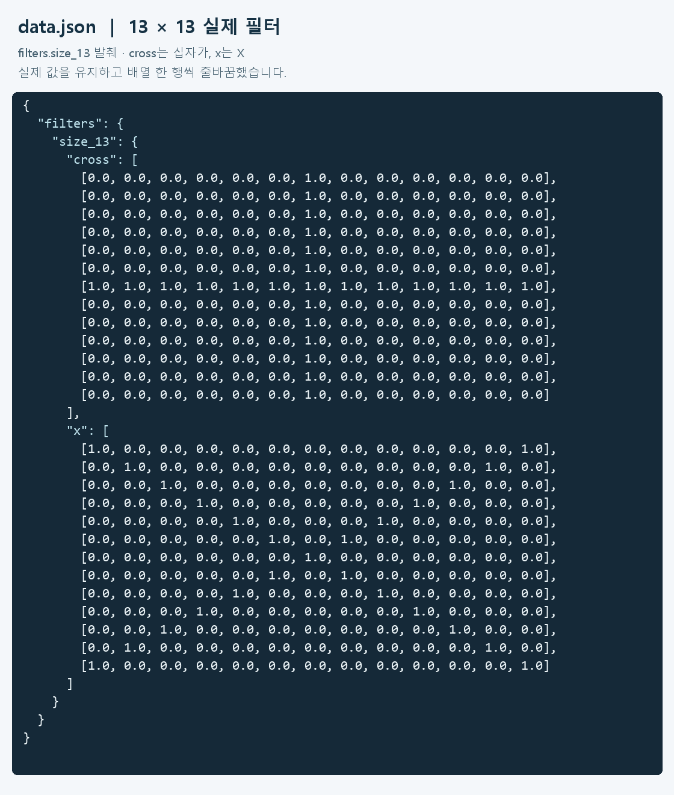


</details>
