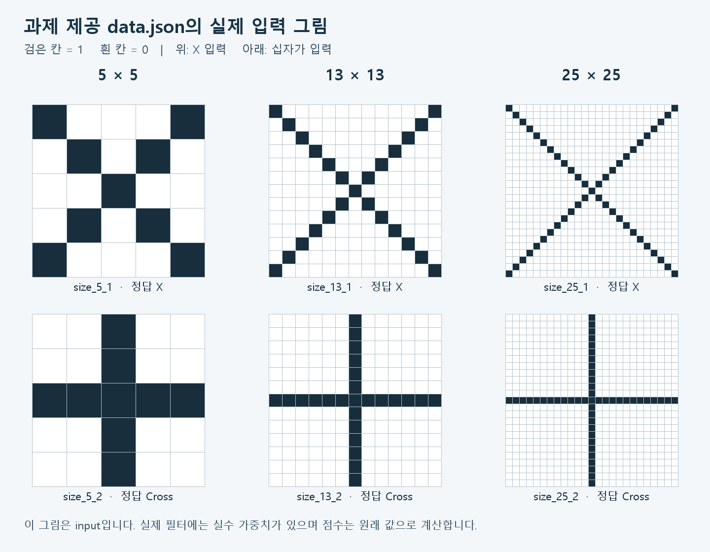
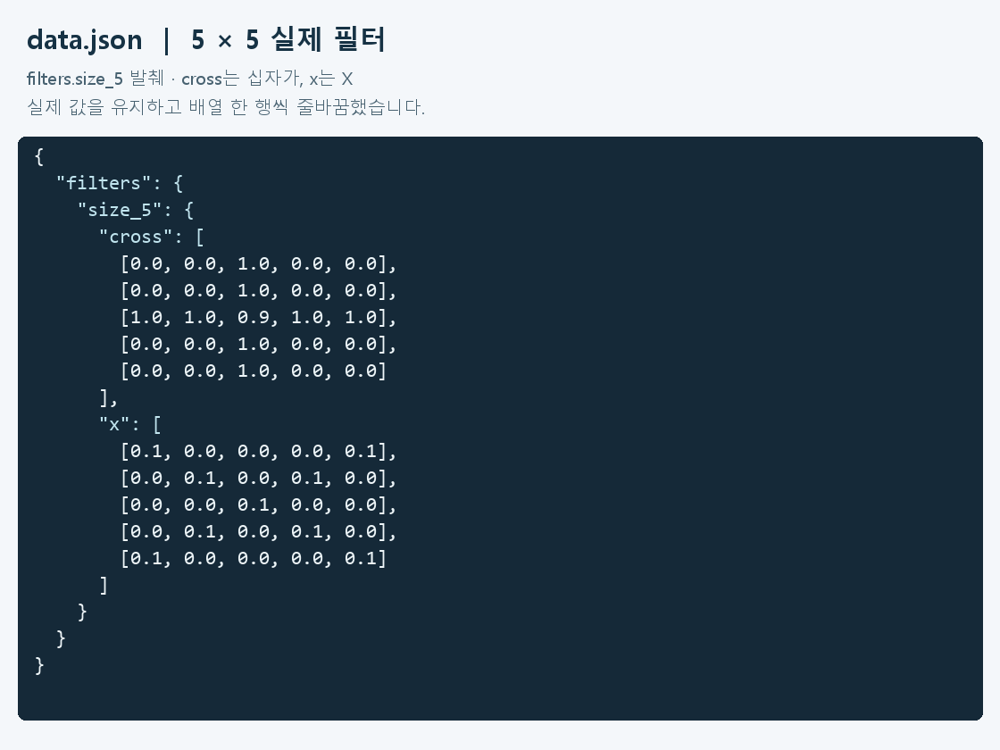
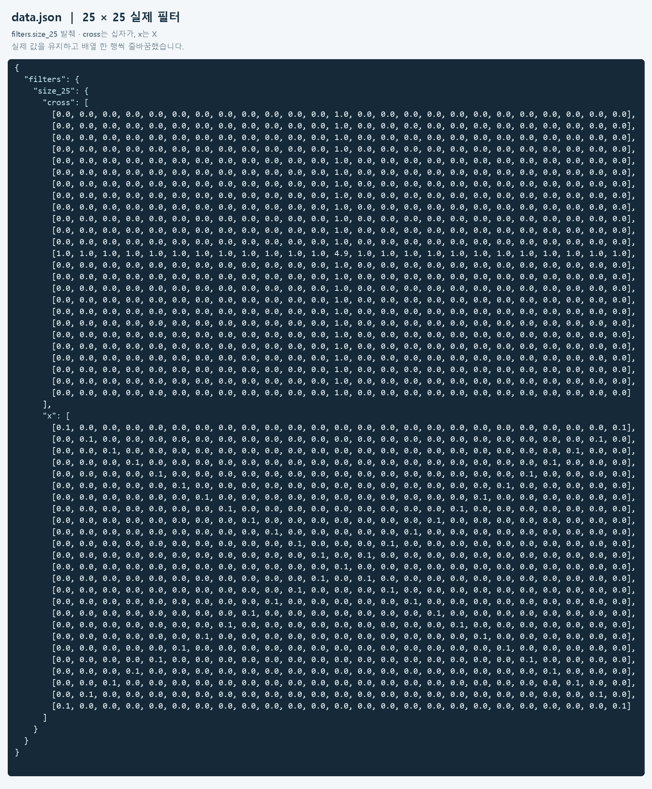
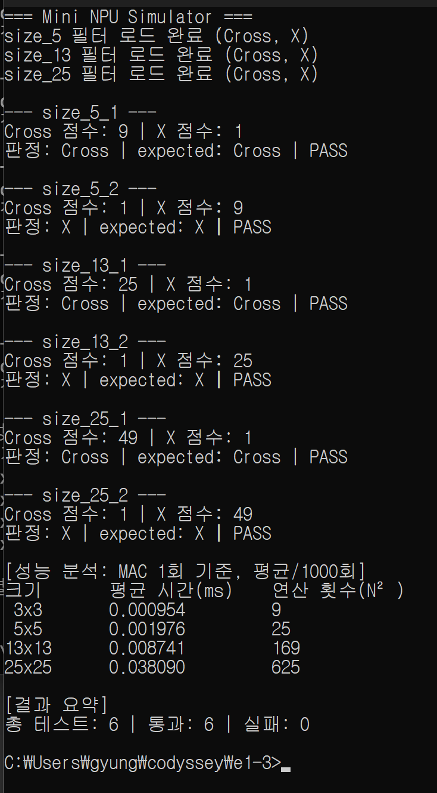

# 코디세이 1-3: Mini NPU Simulator

## 실행 방법

Python 3.8 이상에서 실행합니다. 외부 패키지 설치는 필요 없습니다.
터미널에서 main.py가 있는 폴더로 이동한 다음 실행하세요.

```text
python main.py
```

1을 선택하면 필터 A, 필터 B, 패턴을 각각 3줄씩 입력합니다.
각 줄에는 숫자 3개를 공백으로 구분해 입력합니다. 잘못 입력한 행만 다시 입력합니다.
2를 선택하면 main.py와 같은 폴더의 data.json을 분석합니다.
직접 모드를 지정하거나 다른 파일을 사용할 수도 있습니다.

```text
python main.py --mode 1
python main.py --mode 2
python main.py --mode 2 --data "다른폴더/data.json"
```

결과를 그림으로 확인하려면 다음 명령으로 5×5 예제 한 개부터 볼 수 있습니다.
`□`는 빈 칸(0), `■`는 채운 칸(1)입니다. 입력 그림, 두 기준 필터, 각각 겹친 칸을 순서대로 표시합니다.
0과 1 이외의 실수 입력에서는 `■`가 0이 아닌 값을 나타내며, 점수는 원래 숫자로 계산합니다.

```text
python main.py --mode 2 --case size_5_1
```

`--case size_13_1` 또는 `--case size_25_1`로 다른 크기도 선택할 수 있습니다.
`--case`를 생략하면 전체 케이스를 처리하며, 한 개를 선택했을 때 요약은 선택한 케이스 기준입니다.

**동봉한 data.json은 직접 생성한 예제입니다. 공식 과제 데이터가 제공되지 않아 공식 데이터의 결과는 확인하지 않았습니다.**
공식 파일을 받으면 data.json을 교체해 실행하고 결과 리포트의 수치를 갱신하세요.

### 사용자 입력 예시

아래 내용을 모드 1에서 순서대로 입력합니다. 앞의 3줄은 A, 다음 3줄은 B, 마지막 3줄은 패턴입니다.

```text
0 1 0
1 1 1
0 1 0
1 0 1
0 1 0
1 0 1
1 0 1
0 1 0
1 0 1
```

A 점수는 1, B 점수는 5이며 판정은 B입니다. 측정 시간은 실행 환경에 따라 달라집니다.

## 구현 요약

### 라벨 정규화

- `normalize_label`은 `+`, `cross`, `Cross`를 Cross로, `x`, `X`를 X로 변환합니다.

### MAC 연산

- 2차원 리스트에 패턴과 필터를 저장하고 `matrix[i][j]`로 읽고 쓸 수 있습니다.
- `mac`은 두 겹의 반복문으로 같은 위치의 값을 곱하고 누적합니다.

### 동점 처리 정책

- `abs(a - b) < 1e-9`를 만족하면 UNDECIDED입니다. 정확히 1e-9 차이는 동점이 아닙니다.
- expected는 Cross 또는 X만 허용하므로 UNDECIDED 판정은 FAIL입니다.

### JSON 구조와 입력 검증

- JSON은 filters 아래 size_5/size_13/size_25, 각 그룹 아래 cross/x 배열을 사용합니다.
- patterns는 size_N_idx 키와 input/expected를 가진 객체입니다.
- 행·열 수, 숫자 타입, 유한성, 필터 라벨 중복, 누락 및 키 형식을 검증합니다.
- 필터 오류는 관련 패턴마다 FAIL로 기록하며 다른 크기의 정상 케이스는 계속 분석합니다.
- 파일을 열 수 없거나 최상위 patterns 구조가 잘못되면 원인을 출력하고 정상적으로 종료합니다.

#### data.json에 설정된 패턴

검은 칸은 1, 흰 칸은 0입니다. 아래 그림은 동봉 예제 파일의 실제 배열을 읽어 시각화했습니다.
각 크기의 1번 입력은 십자가(Cross), 2번 입력은 X이며, 해당 모양의 기준 필터와 배열이 같습니다.
따라서 5×5, 13×13, 25×25에서 같은 모양끼리의 점수는 각각 9, 25, 49이고, 다른 모양끼리는 가운데만 겹쳐 1점입니다.



#### 크기별 실제 JSON 내용

아래는 같은 `data.json`에서 `filters.size_5`, `filters.size_13`, `filters.size_25`를 각각 발췌한 이미지입니다.
실제 숫자와 키를 유지하고, 읽기 쉽도록 2차원 배열의 한 행을 이미지의 한 줄로 정렬했습니다.
각 이미지에는 십자가 필터 `cross`와 X 필터 `x`의 전체 행렬이 들어 있습니다.
다른 크기의 필터와 `patterns` 영역은 발췌 범위에서 제외했습니다.

**5×5 JSON**



**13×13 JSON**


**25×25 JSON**



### 선택 과제: 패턴 생성기

- 선택 과제로 패턴 생성기를 구현했습니다. `generate(n)`은 중앙 행·열에 1을 넣어 십자가를 만들고, 두 대각선(`i == j`, `i + j == n - 1`)에 1을 넣어 X를 만듭니다. 나머지 칸은 0입니다.
- `py main.py --generated-filters`로 실행하면 3×3 필터 A(십자가)와 B(X)가 자동으로 생성됩니다. 비교할 패턴 3줄만 입력하면 됩니다. JSON 모드의 크기별 성능 측정에도 같은 생성 함수를 사용합니다.

## 결과 리포트

### 판정 결과와 실패 원인 분석

1. 동봉 예제에는 5×5, 13×13, 25×25별 Cross와 X 패턴이 하나씩 있어 총 6건입니다.
2. 실제 실행 결과는 전체 6건, 통과 6건, 실패 0건입니다. 원문 출력은 example_result.txt에 있습니다.
3. 이 결과는 동봉 예제에 대한 결과이며 공식 데이터의 통과를 보장하지 않습니다.
4. expected의 `+`와 필터 키 `cross`를 Cross로 통일해 문자열 표기 차이로 생기는 실패를 방지했습니다.
5. expected와 필터 키의 `x` 역시 X로 통일해 비교했습니다.
6. 예제의 동일 패턴 점수는 2N−1이고 다른 패턴과 겹치는 중앙 위치의 점수는 1이므로 모두 구분되었습니다.
7. epsilon 정책을 적용했지만 이 예제에는 근접 동점이 없어 epsilon이 PASS로 바꾼 케이스는 없습니다.
8. 별도로 0.9와 0.8999999999999999를 비교하여 UNDECIDED 처리를 확인했습니다.
9. 두 점수가 같은 경우 expected를 임의로 선택하지 않으며, FAIL 원인에 동점 규칙을 표시합니다.
10. 오류 검증용 데이터 8건에서는 정상 4건이 PASS, 배열 크기·라벨·키 오류 및 동점 4건이 FAIL이었습니다.
11. 크기와 키 오류는 데이터/스키마 문제이며 MAC 수식 자체의 문제와 구분해야 합니다.
12. 정상 형태의 데이터에서 예측이 다르면 라벨, 패턴 값, 필터 구성, MAC 구현 순서로 확인해야 합니다.
13. 작은 실수 차이만 있는 경우에는 부동소수점 표현 및 epsilon 비교 정책을 우선 확인해야 합니다.

### 시간 복잡도와 성능 분석

14. MAC은 N개의 행에서 N개의 원소를 방문하므로 곱셈 N²회와 누적 덧셈 N²회를 수행합니다.
15. 따라서 MAC 한 번의 시간 복잡도는 O(N²)이며 두 필터를 계산해도 상수 2만 늘어나 O(N²)입니다.
16. 표의 N²는 MAC 단계 수이며 곱셈과 덧셈을 각각 센 총 산술 연산 수는 약 2N²입니다.
17. 각 크기에 대해 생성한 Cross 패턴과 X 필터를 사용하며 준비 및 파일 읽기·화면 출력은 측정 구간에서 제외합니다.
18. 준비 호출 1회 후 MAC 함수 1,000회를 반복한 전체 시간을 나눴으므로 함수 호출과 반복 제어 비용은 포함됩니다.
19. 아래 표는 Python 3.13.3 환경의 한 차례 실측이며 성능 기준값이나 실행 시간 보장은 아닙니다.
20. 3×3에서 25×25로 커지면 원소 수는 약 69.4배지만 작은 입력의 고정 비용 때문에 시간이 정확히 같은 비율로 증가하지는 않습니다.
21. 측정에는 시스템 부하와 타이머 변동이 있으므로 복잡도는 반복문 구조를 근거로 설명하고 실측은 보조 자료로 해석합니다.
22. 입력과 필터의 저장 공간은 O(N²), 검증된 배열을 받는 MAC 자체의 추가 공간은 O(1)입니다.

| 크기 | 평균 시간(ms), MAC 1회 | MAC 단계 수 N² |
|---|---:|---:|
| 3×3 | 0.001432 | 9 |
| 5×5 | 0.002542 | 25 |
| 13×13 | 0.013762 | 169 |
| 25×25 | 0.052428 | 625 |

### 재현성 확인

정상 예제 6건, 오류 포함 8건의 총합, 사용자 입력 오류 후 재입력,
3×3 X 판정, 근접 동점, epsilon 경계값을 확인했습니다.
공식 data.json의 스키마가 위 구조와 다르면 파일에 맞춘 추가 확인이 필요합니다.

### 실행 화면

현재 프로그램은 `Cross`를 `십자가(Cross)`, `X`를 `엑스(X)`, `expected`를 `정답`, `PASS/FAIL`을 `통과(PASS)/실패(FAIL)`로 표시합니다.
내부 라벨과 정답 비교에는 원문의 표준 라벨 `Cross/X`를 사용합니다.

```text
십자가(Cross) 점수: 9 | 엑스(X) 점수: 1
판정: 십자가(Cross) | 정답: 십자가(Cross) | 통과(PASS)
```

아래 스크린샷은 한글 표시 변경 전의 실행 기록입니다.
아래 이미지는 사용자가 로컬 `codyssey/e1-3`에서 실행한 결과를 제공한 원본 스크린샷입니다.
동봉한 자체 예제 `data.json`의 6개 케이스가 모두 PASS이고, 요약은 총 6건 / 통과 6건 / 실패 0건입니다.
3×3, 5×5, 13×13, 25×25의 MAC 평균 시간(1,000회)과 N²도 표시됩니다.
화면의 측정값과 위 결과 리포트의 값은 서로 다른 실행에서 나온 값으로, 실행 환경과 시점에 따라 달라질 수 있습니다.
공식 과제 데이터에 대한 검증은 별도로 필요합니다.


